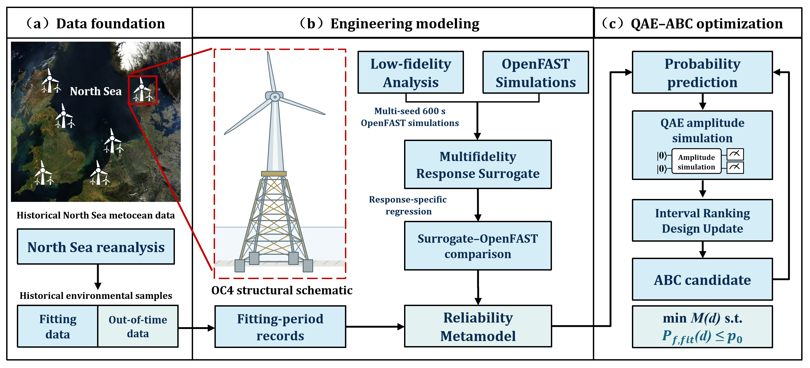
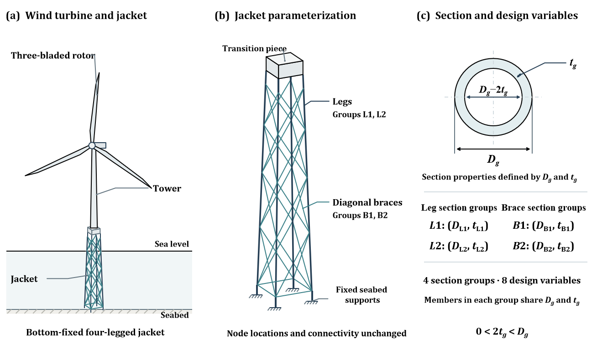
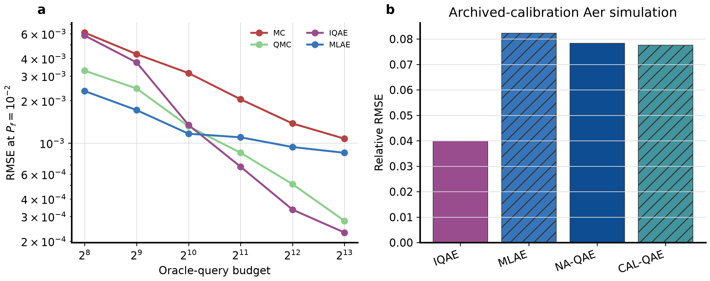
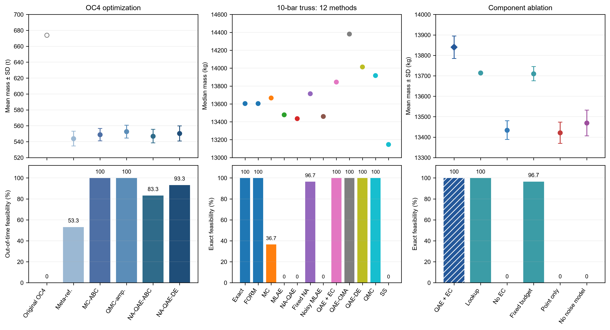
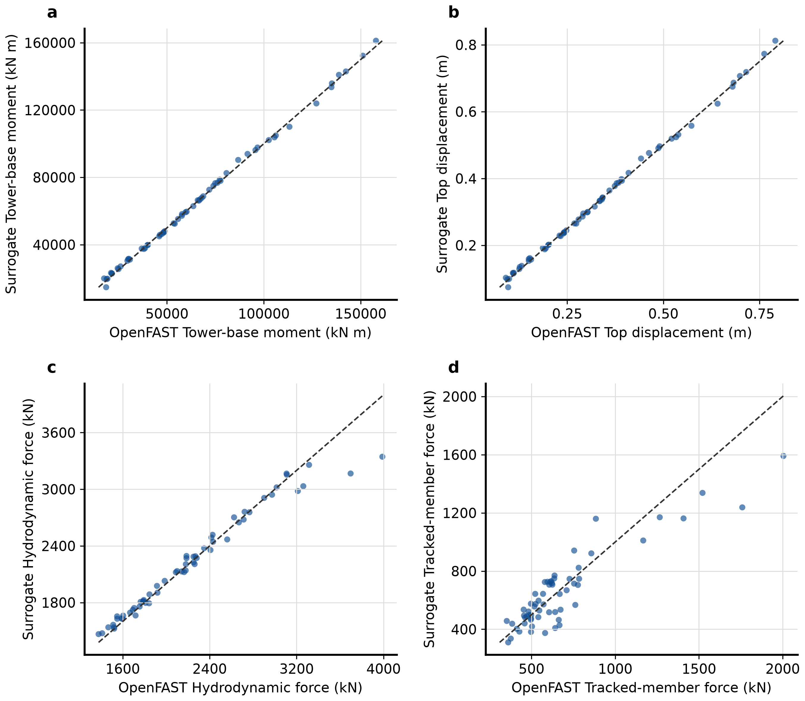
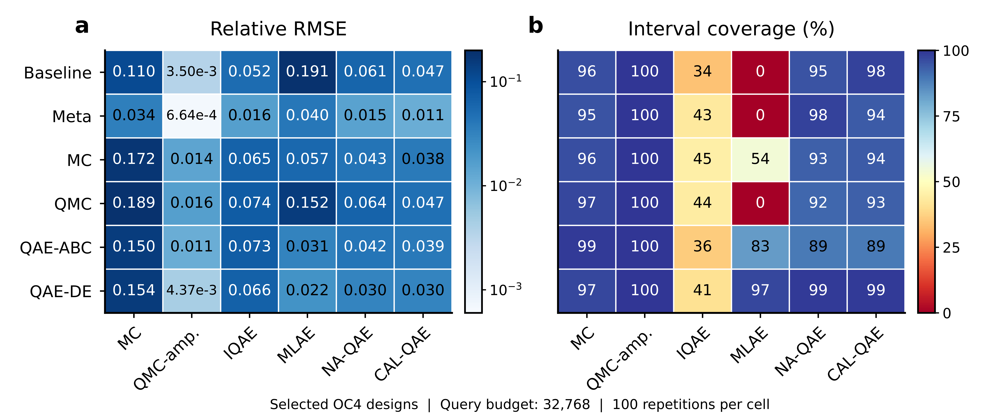
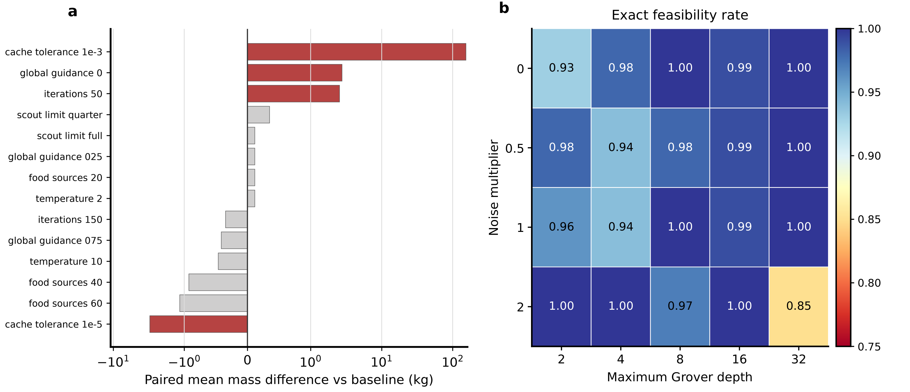

# QAE-ABC

### QAE-ABC: Quantum amplitude estimation-assisted reliability-constrained member sizing for fixed-base offshore wind turbine jackets

[Method](#method-at-a-glance) · [Results](#experimental-evidence) · [Figures](#manuscript-figures) · [Experiments](#experimental-design) · [Data](#datasets-tables-and-supplements) · [Reproduction](#reproduction) · [Structure](#repository-structure)

QAE-ABC connects historical wind and wave records, multi-fidelity structural-response models, quantum amplitude estimation (QAE), and artificial bee colony (ABC) search for reliability-constrained member sizing of fixed-base offshore wind turbine jackets. Probability intervals guide candidate ranking and adaptive query allocation. Analytic benchmarks, reversible quantum circuits, a 10-bar truss, and the OC4 jacket connect estimator behavior to structural optimization and independent design assessment.

This repository packages the computational code, **13 experiment entry points**, **four fitted model bundles**, **18 Parquet datasets**, **13 main result tables** (`Table4.csv` through `Table16.csv`, transcribed cell-for-cell from the revised manuscript), **five supplement data packages** (37 CSV files under `data/supplement/`), and **12 manuscript figures** (PNG + PDF). Raw environmental download caches are also included. The engineering optimization loop uses scalar-probability amplitude simulation; separate functional-circuit experiments assess the quantum implementation.

## At a glance

| Item | Study configuration |
| --- | --- |
| Primary task | Minimize structural mass under a modeled system response-exceedance constraint |
| Structural benchmark | 10-bar truss with four cross-sectional-area groups |
| Engineering case | OC4 bottom-fixed jacket, with four diameter/thickness groups and eight design variables |
| Main environmental record | North Sea, 54.0 degrees N / 6.5 degrees E, 2000–2024 |
| Environmental sample size | 219,168 hourly rows; 218,136 complete-core records |
| Observation cross-check | NDBC 44025, 2014–2023; 81,459 time-paired rows, not colocated with the North Sea site |
| Engineering response samples | 5,000 LF cases and 1,200 successful 600 s HF runs (20 design–environment cells × 60 wave seeds) |
| High-fidelity solver | [OpenFAST 5.0.0](https://github.com/OpenFAST/openfast) — official repository, [release v5.0.0](https://github.com/OpenFAST/openfast/releases/tag/v5.0.0) |
| Reliability metamodel | 4,137 development designs plus 828 independent holdout designs; labels evaluated over 8,192 environmental samples per design ([FC-4](data/supplement/MF600s/)) |
| Final dynamic checks | 24 independent 600 s verification runs of the selected design (8 envelope conditions × 3 wave seeds), all passing ([FC-7](data/supplement/MF600s/)) |
| Quantum evidence | Scalar-amplitude simulations, ideal functional circuits, calibrated-noise simulations and compiled resources |
| Hardware status | No real-QPU execution is claimed |
| Selected-design outcome | 537.13 t (−20.29% vs the 673.88 t original OC4), independently re-evaluated P_f,out = 1.331×10⁻³ (β_out ≈ 3.0) |
| Main result tables | 13 CSV files, [Table 4–16](#main-result-tables), values from the revised manuscript |
| Supplement packages | [Five self-contained packages](#supplement-packages) under `data/supplement/` |
| Manuscript figures | [Figure 1–12 index](#manuscript-figures) · [PNG previews](Figures/) · [PDF files](Figures/pdf/) |
| Packaged tests | 32 computational tests pass in this snapshot; see [Reproduction](#reproduction) |
| Research data | [Dataset guide](datasets/DATASET.md) · [Zenodo archive, DOI 10.5281/zenodo.23029471](https://doi.org/10.5281/zenodo.23029471) |

## Research question

A probability estimator can have a small average error while still producing unreliable decisions near a feasibility boundary. During optimization, repeated selection can amplify optimistic estimation errors: an apparently lightweight design may be selected because its exceedance probability was underestimated.

The study examines the following proposition:

> Probability-estimation accuracy should be evaluated together with interval coverage, selection behavior, and independently checked design feasibility—not only as a stand-alone RMSE improvement.

The evidence follows four connected questions: how estimators behave under controlled probabilities, whether the quantum components implement the intended event logic, how estimation errors affect structural search, and what changes when the workflow is transferred to surrogate-assisted offshore engineering.

## Method at a glance

[](Figures/pdf/Figure2.pdf)

*Figure 2. Historical environmental records support engineering response models and reliability labels. ABC proposes designs, while probability estimates and intervals inform candidate ranking. Click the figure to open its PDF.*

The workflow combines six components:

1. **Environmental characterization.** Preserve hourly records, fit-period and temporal-test partitions, marginal/dependence information, and variable-specific observation checks.
2. **Structural response modeling.** Use finite elements for the truss and LF/OpenFAST samples for OC4, followed by response-specific surrogate evaluation.
3. **Probability estimation.** Compare classical sampling, QAE-family estimators, interval coverage, query accounting and controlled-noise behavior.
4. **Confidence-aware ABC search.** Rank and update candidate designs using reliability estimates and uncertainty information under a mass objective.
5. **Refinement and mechanism checks.** Separate the effects of confidence selection, adaptive precision, noise treatment, lookup logic and active/endpoint refinement.
6. **Independent assessment.** Examine exact truss probabilities, held-out designs, temporal environments, and selected-design dynamic responses.

The generic design problem is:

$$
\min_{\mathbf d\in\mathcal D} M(\mathbf d)
\quad\text{subject to}\quad
P_f(\mathbf d)=\Pr[g(\mathbf d,\boldsymbol\xi)\leq 0]\leq p_{\mathrm{target}}.
$$

Here, the design domain, limit states and reliability labels are case-specific. The full truss variant includes exact-probability endpoint refinement; its results must not be attributed solely to the QAE estimator. OC4 reliability labels are surrogate-based system-response exceedances under the stated operating-environment and calibrated-capacity definitions.

Core implementations are in [optimization/abc.py](algorithm/qae_abc/optimization/abc.py), [quantum/likelihood.py](algorithm/qae_abc/quantum/likelihood.py), [quantum/functional_oracle.py](algorithm/qae_abc/quantum/functional_oracle.py), and [reliability/oc4.py](algorithm/qae_abc/reliability/oc4.py).

### Engineering parameterization

[](Figures/pdf/Figure1.pdf)

*Figure 1. Four member groups define eight diameter/thickness variables while retaining the jacket topology. [Figure 3](Figures/pdf/Figure3.pdf) details the scalar-probability amplitude-estimation interface used within the engineering search.*

## Experimental evidence

The previews below use the manuscript figure set in [`Figures/`](Figures/). Click a preview to open its corresponding PDF; the [complete figure index](#manuscript-figures) includes all 12 PNG/PDF pairs.

### Probability estimation and structural decisions

<table>
<tr>
<td width="50%"><a href="Figures/pdf/Figure6.pdf"></a></td>
<td width="50%"><a href="Figures/pdf/Figure9.pdf"></a></td>
</tr>
<tr>
<td><strong>Figure 6 · Probability estimation.</strong> Query-budget convergence and simulated-noise comparisons characterize estimation accuracy.</td>
<td><strong>Figure 9 · Truss optimization.</strong> Endpoint mass is assessed together with exact feasibility across twelve algorithm configurations.</td>
</tr>
</table>

The analytic and nonlinear studies compare estimation rather than assuming that an asymptotic query argument guarantees practical advantage. The truss comparisons and ablations then test whether estimator behavior translates into sound design selection. Confidence treatment and endpoint refinement are distinct contributors, so the repository retains their separate evidence.

See the [paired comparisons with Holm-adjusted p-values](data/Table8.csv), the [ABC parameter-sensitivity results](data/Table9.csv), and the [probability-module ablation](data/Table11.csv). The module ablation (Meta-reference / MC / NA-QAE under matched surrogate, seeds, and budgets) is a classical-simulation result and **not a demonstration of quantum-hardware advantage**; its process files are packaged in [`data/supplement/Quantum_Module_Contribution/`](data/supplement/Quantum_Module_Contribution/README.md).

### Engineering response and design assessment

<table>
<tr>
<td width="50%"><a href="Figures/pdf/Figure5.pdf"></a></td>
<td width="50%"><a href="Figures/pdf/Figure8.pdf"></a></td>
</tr>
<tr>
<td><strong>Figure 5 · Response models.</strong> Predictions are compared with OpenFAST for each structural-response quantity.</td>
<td><strong>Figure 8 · Optimization results.</strong> Truss benchmark, component effects, and the revised 600 s OC4 optimization endpoints are summarized together.</td>
</tr>
<tr>
<td width="50%"><a href="Figures/pdf/Figure11.pdf"></a></td>
<td width="50%"><a href="Figures/pdf/Figure12.pdf"></a></td>
</tr>
<tr>
<td><strong>Figure 11 · Design selection.</strong> Search settings and estimation error are examined for their effects on structural decisions.</td>
<td><strong>Figure 12 · Jacket probability estimates.</strong> Relative error and interval coverage are compared across the six representative designs of the revised 600 s chain.</td>
</tr>
</table>

Headline results, each linked to its packaged table:

- The frozen NA-QAE-ABC chain reaches **537.13 t** (−20.29% against the 673.88 t original OC4) with independently re-evaluated P_f,out = 1.331×10⁻³ ([Table 14](data/Table14.csv)); all 24 direct 600 s checks of the selected design pass the demand-to-capacity screen ([Table 15](data/Table15.csv)).
- Over 30 paired seeds the five ABC configurations span 543.81–552.70 t mean mass; NA-QAE-ABC uses 4.78×10⁶ median queries versus 9.09×10⁶ for MC-ABC—a 47% reduction ([Table 7](data/Table7.csv)).
- Response surrogates reach holdout R² 0.86–0.97 across Y1–Y5 ([Table 5](data/Table5.csv)); the design-level reliability metamodel reaches holdout R² 0.919 and 0.947 for its two targets ([Table 6](data/Table6.csv)).
- Foundation flexibility erodes fixed-base feasibility: stiff/reference/soft supports push β_out to −0.44/−1.10/−1.73 and return 0/30 feasible reoptimization runs ([Table 10](data/Table10.csv), supplement [Foundation_Flexibility](data/supplement/Foundation_Flexibility/README.md)).
- Multi-site recalibration (NDBC 44025 / 41025 / 46026) returns 30/30 feasible runs per site ([Table 16](data/Table16.csv), supplement [Multi-Site_Value](data/supplement/Multi-Site_Value/)).
- Cross-platform OpenFAST regression passes 76/76 channels on Linux ATLAS with a maximum relative L2 error of 0.0061 ([Table 4](data/Table4.csv), supplement [OpenFAST_Value](data/supplement/OpenFAST_Value/)).

The functional-circuit experiment constructs and executes a **42-logical-qubit** circuit using ideal Aer matrix-product-state simulation, with 100 repetitions and an actual query budget of 8,192. This supports circuit-level simulation evidence, not a real-device demonstration. The separate OC4 functional-oracle study reports approximation and compilation behavior; its engineering acceptance must be assessed independently of whether the circuit was successfully built.

Under the revised MF600s protocol, all high-fidelity simulations use [OpenFAST 5.0.0](https://github.com/OpenFAST/openfast) ([release v5.0.0](https://github.com/OpenFAST/openfast/releases/tag/v5.0.0)) with a 60 s initialization interval and a 600 s production window, [60, 660] s, for response extraction. The response basis is 1,200 successful runs from 20 design–environment cells × 60 wave seeds across four structural designs ([FC-2](data/supplement/MF600s/)), and the selected 537.13 t design passed independent verification with 24 additional 600 s runs (8 envelope conditions × 3 wave seeds; [FC-7](data/supplement/MF600s/)). These are limited dynamic checks—not a complete fatigue, design-load-case or certification campaign. See the [600 s response means](data/Table12.csv) and the [out-of-time assessment](data/Table13.csv).

## Manuscript figures

The [`Figures/`](Figures/) directory follows manuscript numbering from **Figure 1 to Figure 12**. PNG files provide browser previews; the matching files in [`Figures/pdf/`](Figures/pdf/) are available for publication and LaTeX use. Each row below links both formats of the same figure.

| Figure | Contents | PNG | PDF |
| --- | --- | --- | --- |
| 1 | Offshore jacket configuration and section design variables | [PNG](Figures/Figure1-Structure.png) | [PDF](Figures/pdf/Figure1.pdf) |
| 2 | Engineering evaluation and QAE-ABC optimization framework | [PNG](Figures/Figure2-Framework.png) | [PDF](Figures/pdf/Figure2.pdf) |
| 3 | Scalar-probability amplitude estimation in the engineering optimization loop | [PNG](Figures/Figure3-QAE-ABC.png) | [PDF](Figures/pdf/Figure3.pdf) |
| 4 | Historical wind–wave distributions, dependence and upper-tail quantiles | [PNG](Figures/Figure4-Dataset.png) | [PDF](Figures/pdf/Figure4.pdf) |
| 5 | Response-surrogate predictions compared with OpenFAST results | [PNG](Figures/Figure5.png) | [PDF](Figures/pdf/Figure5.pdf) |
| 6 | Probability-estimation convergence and simulated-noise comparisons | [PNG](Figures/Figure6.png) | [PDF](Figures/pdf/Figure6.pdf) |
| 7 | Estimation error versus query budget at four probability scales | [PNG](Figures/Figure7.png) | [PDF](Figures/pdf/Figure7.pdf) |
| 8 | Jacket optimization, truss comparisons and algorithm ablations | [PNG](Figures/Figure8.png) | [PDF](Figures/pdf/Figure8.pdf) |
| 9 | Truss endpoint mass and exact feasibility across twelve configurations | [PNG](Figures/Figure9.png) | [PDF](Figures/pdf/Figure9.pdf) |
| 10 | Algorithm-component effects and exact endpoint correction | [PNG](Figures/Figure10.png) | [PDF](Figures/pdf/Figure10.pdf) |
| 11 | Search-parameter sensitivity and estimation effects on design selection | [PNG](Figures/Figure11.png) | [PDF](Figures/pdf/Figure11.pdf) |
| 12 | Estimator performance across the six representative OC4 designs (600 s chain) | [PNG](Figures/Figure12.png) | [PDF](Figures/pdf/Figure12.pdf) |

## Experimental design

### Four evidence modules

| Module | Question | Evidence |
| --- | --- | --- |
| I. Probability estimation | How do error, coverage and query use vary? | Analytic and nonlinear benchmarks |
| II. Quantum implementation | Does the constructed logic represent the intended event, and at what resource cost? | Functional circuits, calibration-snapshot noise and OC4 oracle resources |
| III. Structural optimization | Do probability estimates support feasible, low-mass decisions? | Truss comparisons, ablation and sensitivity |
| IV. Engineering transfer | Does the workflow remain useful under modeled environmental and response uncertainty? | OC4 surrogates, reliability, optimization and validation |

### Selected protocol settings

| Setting | Value / scope |
| --- | --- |
| Analytic target probabilities | 0.1, 0.01, 0.001, 0.0001 |
| Analytic query budgets | 256, 512, 1,024, 2,048, 4,096, 8,192 |
| Analytic/nonlinear stochastic repetitions | 100 per configured cell |
| Nonlinear reference audit | 2^24 Sobol points per setting |
| Confidence level | 0.95 in the retained baseline configurations |
| Truss independent runs | 30 |
| Truss ABC food sources / iterations | 30 / 100 |
| Truss target reliability index | 3.0 |
| Truss adaptive query budgets | 512, 2,048, 8,192 |
| North Sea temporal partition | Fit: 2000–2019; temporal evaluation: 2020–2024 |
| OC4 response evaluation | 1,200-run MF600s basis; leave-one-cell-out and full evaluation ([Table 5](data/Table5.csv)) |
| OC4 reliability evaluation | 4,137 development designs and 828 holdout designs ([Table 6](data/Table6.csv)) |

These settings belong to different experimental layers; there is no single interchangeable budget for every experiment. Consult [configs/](experiments/configs/) and the relevant script for its precise protocol. The 4,137 × 8,192 design–environment combinations of the revised reliability chain ([FC-4](data/supplement/MF600s/)) are surrogate evaluations, not that many OpenFAST runs.

### Main experiment entry points

| Entry | Contents |
| --- | --- |
| [E1-analytic.py](experiments/source/E1-analytic.py) | Analytic probability-estimator benchmark |
| [E2-nonlinear.py](experiments/source/E2-nonlinear.py) | Nonlinear estimator comparison |
| [E3-circuit.py](experiments/source/E3-circuit.py) | Functional-circuit QAE |
| [E4-noise.py](experiments/source/E4-noise.py) | Calibrated-noise simulation |
| [E5-truss.py](experiments/source/E5-truss.py) | Main truss optimizer comparison |
| [E6-ablation.py](experiments/source/E6-ablation.py) | Confidence, refinement and lookup ablations |
| [E7-sensitivity.py](experiments/source/E7-sensitivity.py) | QAE parameter sensitivity |
| [E8-surrogate.py](experiments/source/E8-surrogate.py) | OC4 multifidelity response models |
| [E9-reliability.py](experiments/source/E9-reliability.py) | OC4 reliability labels and metamodels |
| [E10-oc4.py](experiments/source/E10-oc4.py) | OC4 reliability-constrained optimization |
| [E11-estimation.py](experiments/source/E11-estimation.py) | Estimators for selected OC4 designs |
| [E12-oracle.py](experiments/source/E12-oracle.py) | OC4 functional-oracle construction and resources |
| [E13-validation.py](experiments/source/E13-validation.py) | Analysis of existing 600 s validation runs |

The numbering identifies the retained source entry points, not experiment completion percentages. The original shared helpers and supplementary historical scripts are outside this compact release; `experiments/common/` is not included. See [experiments/README.md](experiments/README.md) for dependencies and the original-to-current filename mapping.

## Repository structure

```text
QAE-ABC/
├── algorithm/
│   ├── qae_abc/        # Optimization, reliability, quantum and structural code
│   ├── models/         # Four fitted joblib bundles
│   └── README.md
├── experiments/
│   ├── source/         # E1-analytic.py through E13-validation.py
│   ├── configs/        # Retained study configurations
│   ├── tests/          # Computational tests
│   └── README.md
├── datasets/
│   ├── raw/            # Compressed environmental source caches
│   ├── processed/      # Hourly metocean and observation-validation records
│   ├── Truss10/        # Truss design-realization samples
│   ├── OC4/            # Engineering samples and reliability labels
│   └── DATASET.md
├── data/
│   ├── Table4.csv … Table16.csv   # 13 main result tables (revised-manuscript values)
│   └── supplement/     # Five packages: MF600s, Multi-Site_Value, OpenFAST_Value,
│                       #   Foundation_Flexibility, Quantum_Module_Contribution
├── campaign600/      # 600 s OpenFAST campaign: batch definitions, orchestrator,
│                    #   per-shard provenance and result files
├── Figures/
│   ├── Figure*.png     # 12 manuscript figures for browser previews
│   └── pdf/            # Matching Figure1.pdf through Figure12.pdf
├── requirements.txt
├── .gitignore
└── README.md
```

## Datasets, tables and supplements

### Research data

The research datasets are archived on Zenodo with the persistent DOI [10.5281/zenodo.23029471](https://doi.org/10.5281/zenodo.23029471) (CC-BY-4.0). The Zenodo record lists the archive files (DATASET.md and dataset.zip) together with their MD5 checksums. The same dataset snapshot is included in this repository under `datasets/`, so the packaged code and tests run without downloading the archive.

The [dataset guide](datasets/DATASET.md) documents all 18 Parquet files, variable definitions, stored-versus-valid row counts, alias files, temporal/design splits and five read-only Python examples. In particular:

The notes below describe the retained original screening-era snapshot under `datasets/`. The revised-manuscript response, reliability and verification numbers come from the 600 s full chain in [`data/supplement/MF600s/`](data/supplement/MF600s/) and the transcribed tables [`data/Table4.csv`](data/Table4.csv) to [`data/Table16.csv`](data/Table16.csv).

- Truss records share designs; keep all realizations of a design in the same split.
- The 400-case OC4 table already includes the initial 300 and added 100 cases; do not concatenate them twice.
- `datasets/` retains the original screening-era parquet snapshot; its reliability holdout tables carry 1,500 indexed rows but only 300 non-null predictions per held-out prediction column. The revised-manuscript reliability chain uses 4,137 development designs plus an 828-design independent holdout ([FC-4](data/supplement/MF600s/)).
- NDBC checks are not colocated validation of the North Sea engineering environment.
- Frozen response-holdout IDs and some calibration artifacts remain in the original project rather than this dataset directory.

### Main result tables

The [`data/`](data/) directory contains **13 CSV tables**, `Table4.csv` through `Table16.csv`, transcribed from the revised manuscript. Each file has a single header row and English column names; values match the revised LaTeX tables cell for cell, so the CSVs and the paper can be cross-checked directly.

| Table | Contents |
| --- | --- |
| [Table 4](data/Table4.csv) | OpenFAST cross-platform regression checks (four platform/compiler builds) |
| [Table 5](data/Table5.csv) | Response-surrogate holdout metrics for Y1–Y5 |
| [Table 6](data/Table6.csv) | Reliability-metamodel holdout metrics |
| [Table 7](data/Table7.csv) | OC4 optimization endpoints: original jacket plus five ABC variants over 30 paired seeds |
| [Table 8](data/Table8.csv) | Paired mass differences with Holm-adjusted p-values |
| [Table 9](data/Table9.csv) | ABC hyperparameter sensitivity |
| [Table 10](data/Table10.csv) | Foundation-flexibility sensitivity (fixed / stiff / reference / soft supports) |
| [Table 11](data/Table11.csv) | Probability-estimation module ablation (Meta-reference / MC / NA-QAE) |
| [Table 12](data/Table12.csv) | 600 s response means for the selected designs (Y1, Y2, Y4) |
| [Table 13](data/Table13.csv) | Out-of-time response assessment (Y3, Y5) |
| [Table 14](data/Table14.csv) | Six-design optimization endpoints with independent re-evaluation |
| [Table 15](data/Table15.csv) | Member demand-to-capacity checks for selected designs |
| [Table 16](data/Table16.csv) | Multi-site recalibration and transfer (NDBC 44025 / 41025 / 46026) |

### Supplement packages

[`data/supplement/`](data/supplement/README.md) contains **five self-contained packages**, each with its own `README.md` documenting scope, files, units, and the analytical flow. Short data-file names (`FC-*`, `MS-*`, `FF-*`, `QM-*`) follow the package conventions.

| Package | Contents |
| --- | --- |
| [MF600s](data/supplement/MF600s/README.md) | Full-chain reconstruction on 600 s simulations: surrogate fitting, reliability labels, optimization, and validation (`FC-1` … `FC-8`) |
| [Multi-Site_Value](data/supplement/Multi-Site_Value/) | Site-specific recalibration and out-of-time (2020–2023) validation for NDBC 44025 / 41025 / 46026 (`MS-1` … `MS-15`) |
| [OpenFAST_Value](data/supplement/OpenFAST_Value/) | OpenFAST model inputs plus four platform/compiler result tables for cross-platform numerical checks |
| [Foundation_Flexibility](data/supplement/Foundation_Flexibility/README.md) | 1,200 paired 10 s simulations (400 designs x 3 flexible supports), 24 x 600 s validation runs, and 30 reoptimization runs per support (`FF-1` … `FF-5`) |
| [Quantum_Module_Contribution](data/supplement/Quantum_Module_Contribution/README.md) | The probability-module ablation behind [Table 11](data/Table11.csv) under matched surrogate, ABC, seeds, budgets, and noise-free final re-evaluation (`QM-1` … `QM-5`) |

### Saved models

| Model | Role |
| --- | --- |
| [reliability.joblib](algorithm/models/oc4_optimization/reliability.joblib) | OC4 design-level reliability models |
| [response.joblib](algorithm/models/oc4_surrogates/response.joblib) | OC4 multifidelity response models |
| [hgbr.joblib](algorithm/models/truss_surrogate/hgbr.joblib) | Truss reference gradient-boosting surrogate |
| [pce.joblib](algorithm/models/truss_surrogate/pce.joblib) | Sparse polynomial-chaos truss surrogate |

Serialized models require compatible libraries and project classes. Load only trusted joblib files. The [algorithm guide](algorithm/README.md) records historical filenames and explains why original script defaults may differ.

## Installation

Clone the repository and create an isolated Python environment:

```bash
git clone https://github.com/Lutra11/QAE-ABC.git
cd QAE-ABC
python -m venv .venv
```

Windows PowerShell:

```powershell
.\.venv\Scripts\python.exe -m pip install -r requirements.txt
.\.venv\Scripts\Activate.ps1
$env:PYTHONPATH = "$PWD\algorithm"
```

Linux or macOS:

```bash
source .venv/bin/activate
python -m pip install -r requirements.txt
export PYTHONPATH="$PWD/algorithm"
```

The requirements list covers the research Python stack; it is not a version lock. OpenFAST executables, regression model inputs and all original runtime artifacts are **not** bundled by this installation. Numerical, quantum-simulation and engineering workloads have different runtime requirements.

## Reproduction

Run all commands from the repository root, with `PYTHONPATH` pointing to `algorithm/` as shown under [Installation](#installation). The steps below verify, in order: the packaged code and data, the computational tests, the headline numbers, and the supplement-package evidence. Each step states the expected output so the verification can be checked, not just run.

### 1. Verify the packaged code and data

```bash
python -c "import qae_abc; print(qae_abc.__file__)"
python -c "import pandas as pd; d = pd.read_parquet('datasets/Truss10/truss_doe_full.parquet'); print(d.groupby('split').size())"
```

Expected output: the first command prints the `qae_abc` package path; the second reports **5,600 training, 1,190 validation and 1,210 test rows**. Follow [DATASET.md](datasets/DATASET.md) for the environmental, engineering and reliability examples, including split-handling rules that a reproduction must respect.

### 2. Run the computational tests

```bash
python -m pytest experiments/tests -q -p no:cacheprovider --ignore=experiments/tests/test_oc4.py
```

Expected result: **32 passed**. `test_oc4.py` imports helper modules (for example `qae_abc.reliability.foundation` and the OpenFAST DOE drivers) that were retained in the original project workspace and are not part of this snapshot, so it is excluded from the packaged run. A historical full-suite pass on the original workspace is not a claim that a fresh clone passes every test.

### 3. Inspect a main experiment entry point

```bash
python experiments/source/E1-analytic.py --help
```

Interfaces differ between scripts. Some entry points have no argument parser and can start computation even when passed `--help`; inspect the code before invoking it. E13 analyzes and writes summaries of existing 600 s validation runs rather than launching a new campaign.

### 4. Reproduce the headline numbers from the packaged tables

```bash
python -c "import pandas as pd; print(pd.read_csv('data/Table14.csv').to_string(index=False))"
python -c "import pandas as pd; print(pd.read_csv('data/Table7.csv').to_string(index=False))"
```

Expected: Table 14 reports the frozen NA-QAE-ABC chain at **537.13 t** (ΔM = 20.29% against the 673.88 t original OC4), P_f,out = 1.331×10⁻³, Feasible = Yes; Table 7 reports the optimization endpoints over 30 paired seeds, with NA-QAE-ABC at 546.98 ± 8.47 t, 83.3% feasible runs, and 4.78×10⁶ median queries versus 9.09×10⁶ for MC-ABC (a 47% reduction). The remaining tables are indexed in [Main result tables](#main-result-tables); every value is transcribed from the revised manuscript, so CSVs and paper can be cross-checked cell by cell.

### 5. Work through a supplement package

Each package under [`data/supplement/`](data/supplement/README.md) is a self-contained release; start from its `README.md`:

- [MF600s](data/supplement/MF600s/README.md) — the full 600 s chain from surrogate fitting to validation, in analytical order (`FC-1` → `FC-8`).
- [Foundation_Flexibility](data/supplement/Foundation_Flexibility/README.md) — paired support-stiffness simulations, 600 s validation, and per-support reoptimization (`FF-1` … `FF-5`).
- [Quantum_Module_Contribution](data/supplement/Quantum_Module_Contribution/README.md) — the module-ablation process files behind [Table 11](data/Table11.csv). Classical simulation; **not a demonstration of quantum-hardware advantage**.
- [Multi-Site_Value](data/supplement/Multi-Site_Value/) — recalibration inputs and out-of-time validation for the three NDBC sites behind [Table 16](data/Table16.csv).
- [OpenFAST_Value](data/supplement/OpenFAST_Value/) — OpenFAST model inputs plus the four platform result tables behind [Table 4](data/Table4.csv), for cross-platform numerical comparison.

### 6. Observe the runtime contract before formal reruns

The retained implementations preserve historical input/output defaults designed for the original `src/data/results/external` project. This package is **not an out-of-the-box reconstruction of that complete workspace**. Formal reproduction of the full campaign additionally requires the missing shared helper modules (including `run_openfast_oc4_doe` and `run_oc4_low_fidelity_doe`), frozen case IDs, capacities, calibration/model metadata, external tools and path configuration.

Use an isolated workspace, explicitly map current model filenames to the required inputs, and write new results separately from the curated tables. Do not reinterpret a newly chosen split or a smoke run as reproduction of the reported experiment.

## License

The original project code is released under the [MIT License](LICENSE).
